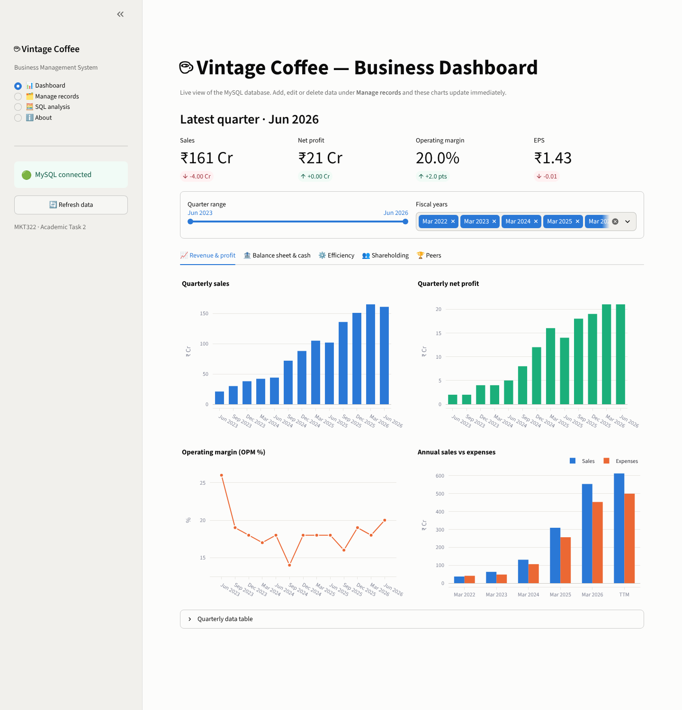
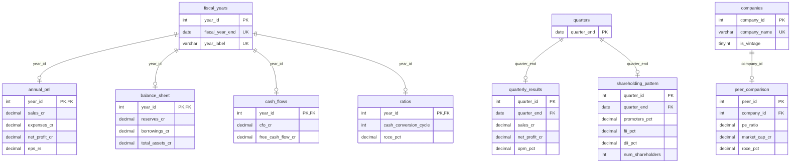
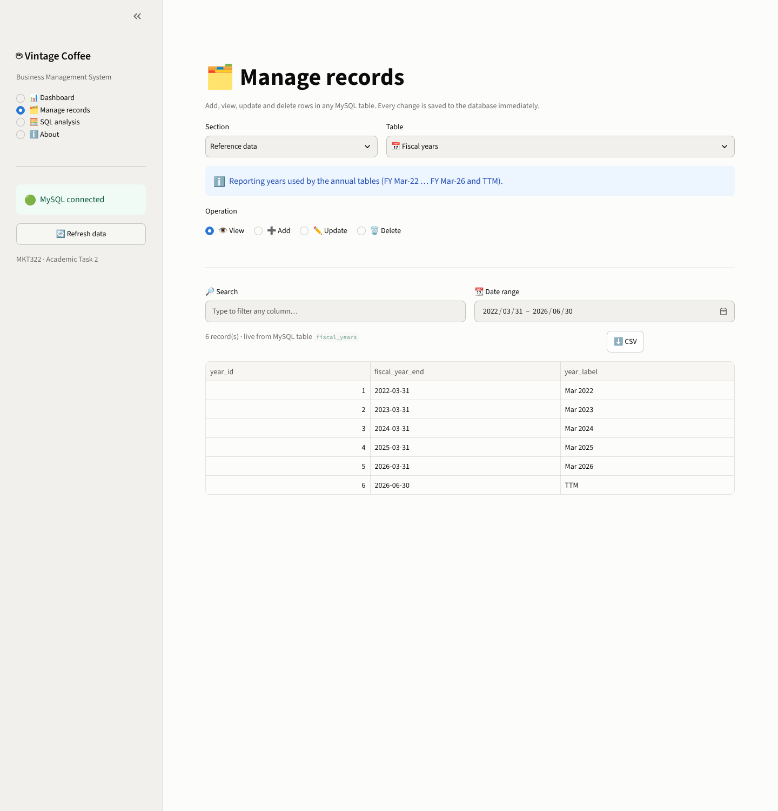
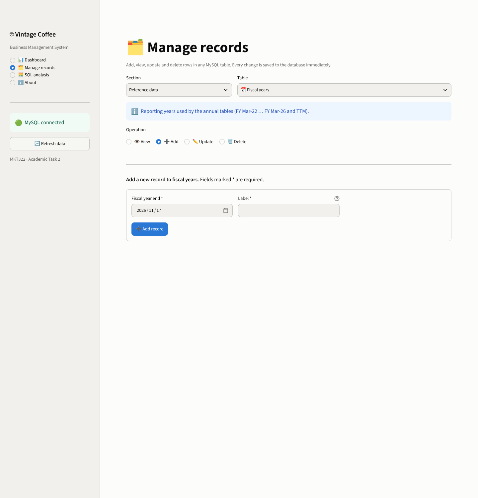
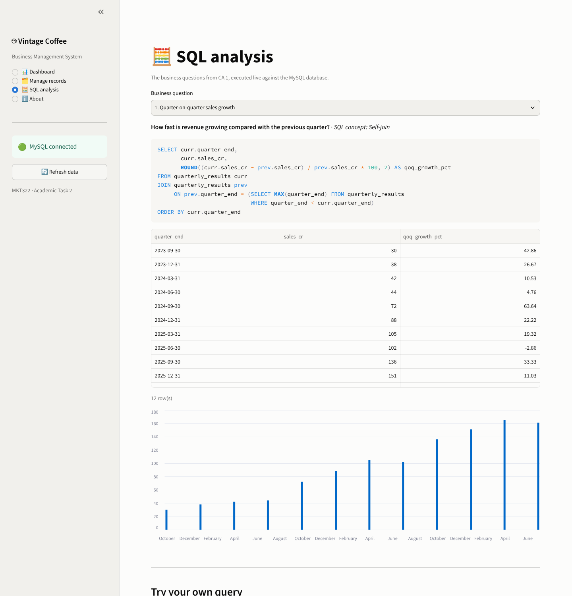

# ☕ Vintage Coffee & Beverages Ltd — Business Management System

**MKT322 Advanced Business Analytics · Academic Task 2**
Live app: `https://<your-app-name>.streamlit.app`  ·  Repo: `https://github.com/<your-username>/<your-repo>`

CA 1 delivered a *read-only* dashboard that read from a bundled SQLite file. CA 2 turns the same
business data into a **live business-management application**: a normalised **MySQL** database,
a **Streamlit** front-end with full **Create / Read / Update / Delete**, input validation, and a
dashboard that always shows the current database contents.



## Features

| Area | What you get |
|---|---|
| **Database** | 10 InnoDB tables, primary keys, foreign keys (`ON DELETE RESTRICT`, `ON UPDATE CASCADE`), unique keys, CHECK constraints, correct data types |
| **CRUD** | One generic engine serves every table: **View** (search, date filter, CSV export) · **Add** · **Update** · **Delete** (with confirmation) |
| **Validation** | Required fields, numeric ranges, whole-number checks, duplicate detection, 4 quarter-end dates only, and business rules (balance sheet balances, cash flows add up, shareholding = 100 %, sales − expenses ≈ operating profit …) |
| **Error handling** | MySQL errors (duplicate, foreign key, out-of-range, connection) are translated into plain-English messages; no raw tracebacks |
| **Real time** | No caching and no hard-coded data: every page reads MySQL on each run, so an edit shows up immediately on every screen |
| **Dashboard** | KPI cards with quarter-on-quarter change, quarter-range and fiscal-year filters, 11 interactive Plotly charts in 5 tabs |
| **SQL analysis** | The CA 1 business questions (self-join, GROUP BY, JOINs, subqueries) run live, plus a safe read-only query box |
| **Security** | Credentials only via Streamlit secrets / env vars; all user input is passed as bound parameters (no SQL injection); query box allows a single SELECT only |

## Database design



CA 1 had seven stand-alone tables with no relationships. For CA 2 they were normalised: three reference tables were added
and every data table now points to one of them through a foreign key.

| Table | Purpose | Key |
|---|---|---|
| `fiscal_years` | reporting years (FY Mar-22 … Mar-26, TTM) | PK `year_id`; unique `fiscal_year_end`, `year_label` |
| `quarters` | quarter-end dates | PK `quarter_end` |
| `companies` | Vintage Coffee + peers | PK `company_id`; unique `company_name` |
| `annual_pnl`, `balance_sheet`, `cash_flows`, `ratios` | yearly financials | PK = FK `year_id` → `fiscal_years` |
| `quarterly_results`, `shareholding_pattern` | quarterly financials / ownership | PK `quarter_id`; unique FK `quarter_end` → `quarters` |
| `peer_comparison` | peer benchmarking | PK `peer_id`; unique FK `company_id` → `companies` |

Because of `ON DELETE RESTRICT`, a year, quarter or company that still has data **cannot** be deleted; the app shows which rows block it.

## Project structure

```
├── streamlit_app.py          # entry point (navigation + connection check)
├── app/
│   ├── db.py                 # engine, credentials, query helpers, friendly errors
│   ├── tables.py             # declarative table/field/rule config -> drives all CRUD forms
│   ├── crud.py               # generic validate / insert / update / delete
│   └── views/                # dashboard.py · manage.py · analysis.py · about.py
├── sql/
│   ├── schema.sql            # CREATE TABLE ... with keys and constraints
│   └── data.sql              # the CA 1 data (generated from the phpMyAdmin dump)
├── scripts/
│   ├── init_db.py            # creates schema + loads data into any MySQL server
│   └── make_data_sql.py      # how data.sql was derived from the CA 1 dump
├── docs/                     # ER diagram, screenshots, original CA 1 dump
├── .streamlit/               # config.toml, secrets.toml.example
└── requirements.txt
```

## Run it locally

Requires Python 3.11+ and a MySQL / MariaDB server (XAMPP works).

```bash
git clone https://github.com/<your-username>/<your-repo>.git
cd <your-repo>
python -m venv .venv && source .venv/bin/activate     # Windows: .venv\Scripts\activate
pip install -r requirements.txt

# 1. create an empty database (phpMyAdmin or CLI)
#    CREATE DATABASE vintage_coffee_db CHARACTER SET utf8mb4;

# 2. add credentials
cp .streamlit/secrets.toml.example .streamlit/secrets.toml     # then edit it (ssl = false for XAMPP)

# 3. create tables + load the CA 1 data
python scripts/init_db.py

# 4. start the app
streamlit run streamlit_app.py
```

`init_db.py` **drops and recreates** the tables, so run it only on a fresh database or when you want to reset the demo data.

## Deploy (Streamlit Community Cloud + cloud MySQL)

Streamlit Cloud cannot reach a MySQL server running on your laptop, so the live app needs a **cloud-hosted MySQL**.

1. **Create a cloud MySQL database.** Any MySQL-compatible host works (for example Aiven, TiDB Cloud, Railway or FreeSQLDatabase — check each provider's current free tier). Note its host, port, user, password and database name, and whether it requires SSL.
2. **Load the data into it** from your computer: put those credentials in `.streamlit/secrets.toml` (`ssl = true` if required) and run `python scripts/init_db.py`.
3. **Push the code to GitHub** (the `.gitignore` keeps `secrets.toml` out of the repository).
4. On <https://share.streamlit.io> choose **New app** → pick the repo, branch `main`, main file `streamlit_app.py`.
5. Open **Advanced settings → Secrets** and paste the same `[mysql]` block from your `secrets.toml`.
6. Deploy, then test Add / Update / Delete on the live link and put the URL at the top of this README.

If the app shows "Cannot reach the MySQL server", check that the database is running (free tiers may pause), the host/port are right and `ssl` matches what the provider requires.

## How the CRUD screens work

*Manage records → choose a table → choose an operation.*

- **View** – live table with free-text search, date-range filter and CSV download.
- **Add** – generated form; foreign-key fields are dropdowns filled from the parent table (only parents without a row yet are offered).
- **Update** – pick a record, the form is pre-filled, save. Editing a quarter-end date cascades to its results.
- **Delete** – pick a record, review it, tick the confirmation box. Blocked with an explanation if other records still reference it.

After each change the page reloads from MySQL and shows a confirmation, so the Dashboard, tables and SQL analysis immediately reflect it.

## Screenshots

| Manage records | Add form | SQL analysis |
|---|---|---|
|  |  |  |

## Data source

Quarterly and annual financials, shareholding pattern and peer data for Vintage Coffee & Beverages Ltd collected from the company's published filings for CA 1 (see `docs/ca1_phpmyadmin_dump.sql`).

## Tech stack

Python · Streamlit · SQLAlchemy · PyMySQL · MySQL/MariaDB · pandas · Plotly
